# Headset Gesture

**English** · [简体中文](README.zh-CN.md)



Turn the button on a wired headset into a programmable input on macOS. Headset Gesture takes exclusive control of the headset's Play/Pause button and maps single, double and triple taps and long presses to keys, shortcuts, media keys, Shortcuts or shell commands.

## Features

- Map **single tap**, **double tap**, **triple tap** and **long press** independently.
- Actions: any key or key combination (F13–F20, letters, Space, Return, Escape, Tab), left/right Control, Option and Command as separate keys, media keys (Play/Pause, Next, Previous, Volume, Mute), a macOS Shortcut, or a shell command.
- Adjustable double-tap interval and long-press threshold, with a tap-only mode for headsets that drop release events.
- An optional on-screen timer while you hold the button, shown at one of seven positions or next to the focused text field.
- A live monitor that shows the raw HID signal, the recognizer state, the mapped output and recent events.
- Menu bar control panel; the Dock icon can be hidden.
- Everything runs locally. See [PRIVACY.md](PRIVACY.md).

## Requirements

- macOS 13 Ventura or later, Apple silicon or Intel.
- A wired headset with an inline button, plugged into the Mac's headphone jack (it appears to macOS as an HID device named `Headset`).

## Install

1. Download the latest `HeadsetGesture-<version>.zip` from [Releases](https://github.com/jarvisluk/HeadsetGesture/releases) and unzip it. Builds are signed with a Developer ID and notarized by Apple.
2. Move **Headset Gesture.app** to the Applications folder and open it.
3. In the dashboard, click **Request Accessibility Permission** and allow it in System Settings → Privacy & Security → Accessibility. Accessibility also covers event listening; Input Monitoring is only needed if you don't grant Accessibility.
4. The app picks up the new permission automatically within a few seconds. If the status does not change, use **Restart App After Granting Access**.

To hide the Dock icon, turn off **Show icon in Dock** in Customization → App or in the menu bar panel, then open the dashboard from the menu bar icon.

## Defaults

| Gesture | Default action |
| --- | --- |
| Single tap | Play/Pause |
| Double tap | F13 |
| Triple tap | Off |
| Long press | F14 (long-press recognition is off by default) |

A single tap fires once the double-tap interval has passed, so the app can tell it apart from a double tap.

## Hardware notes

The `Headset` device is the Mac's headphone-jack remote decoder (`AppleCS42L84Mikey`), not the headset itself. Its report descriptor declares Play/Pause (0xCD), Volume Down (0xEA) and Volume Up (0xE9), but only Apple-standard remotes report the volume buttons. On common Android/CTIA headsets:

- the volume buttons send nothing, or are read as Play/Pause, so all buttons share one set of gestures;
- an off-center press can hold the Play/Pause signal down, and clicks during that time are lost.

If you need separate volume buttons, use an Apple-standard wired headset, or a USB-C or Bluetooth headset.

## About "new" keys

A normally signed app can reliably send the virtual key codes macOS defines, which include F13–F20. F21–F24 or fully custom HID usages require Apple's restricted `com.apple.developer.hid.virtual.device` entitlement or a system extension such as Karabiner VirtualHID, so the app does not offer them.

**Raw virtual key code** mode sends any CGKeyCode from 0 to 127. Undefined codes are only seen by software that listens to raw CGEvents; most apps ignore them.

## Build from source

```sh
swift test
./scripts/build-app.sh
```

The app bundle and a zip are written to `dist/`. The build script signs with the first Developer ID Application certificate in your keychain (or `CODE_SIGN_IDENTITY`) and falls back to ad-hoc signing; with ad-hoc signing macOS may ask for permissions again after every rebuild.

Build, replace the installed copy in `/Applications` and launch it:

```sh
./scripts/build-and-run.sh        # release
./scripts/build-and-run.sh debug  # debug
```

Set `HEADSET_GESTURE_INSTALL_PATH` to install somewhere else.

## Releasing

Maintainers publish signed, notarized builds with one command. See [RELEASE_CHECKLIST.md](RELEASE_CHECKLIST.md).

## License

[MIT](LICENSE) © 2026 Jarvis Luk
